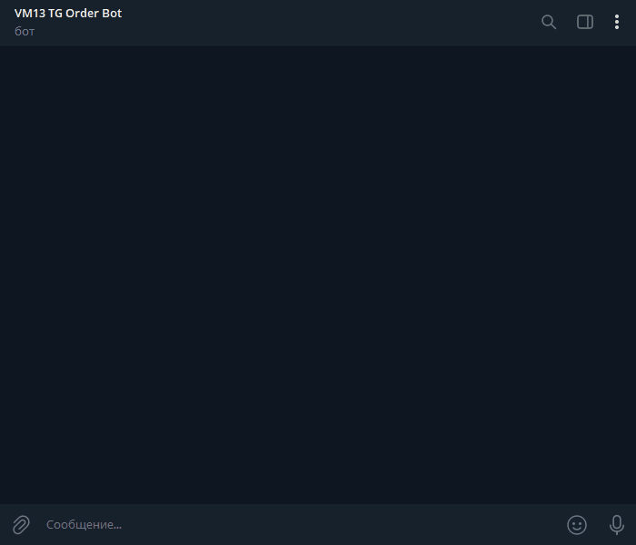
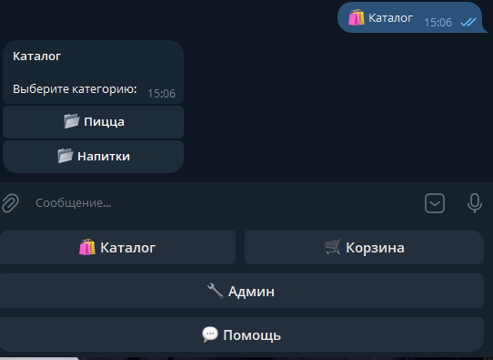
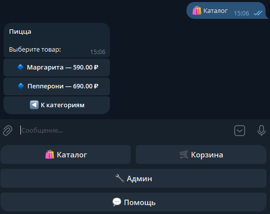
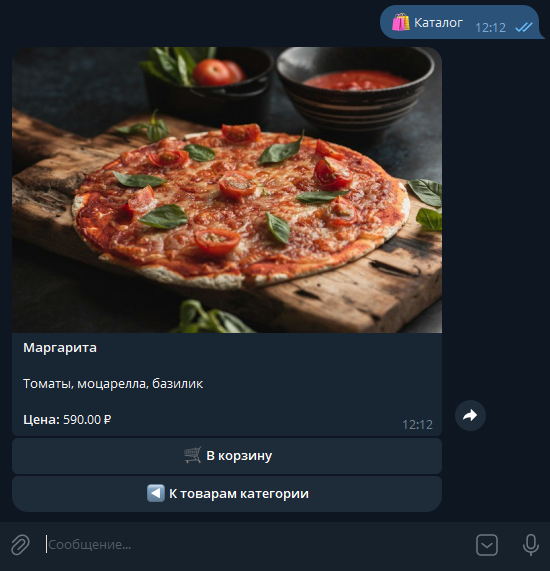
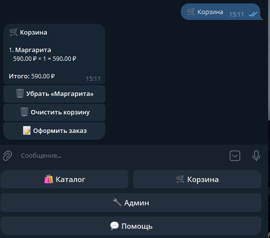
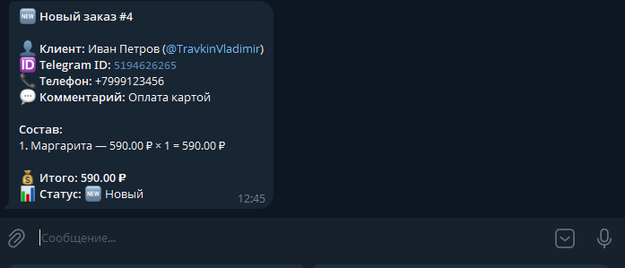
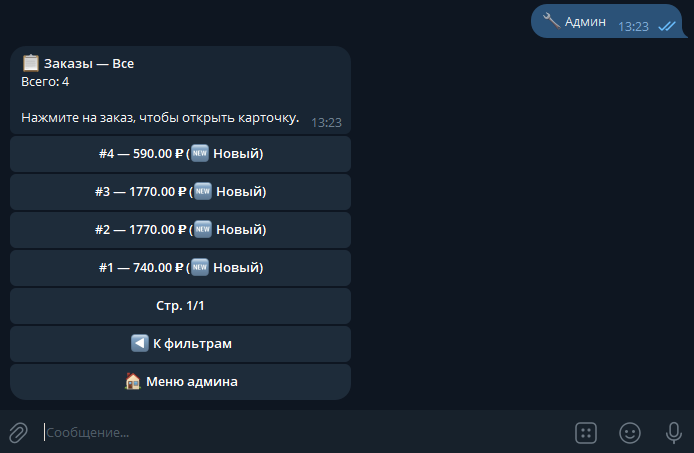
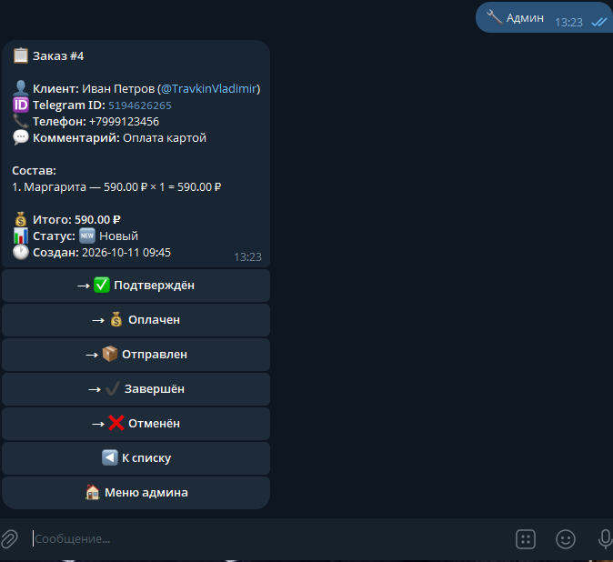
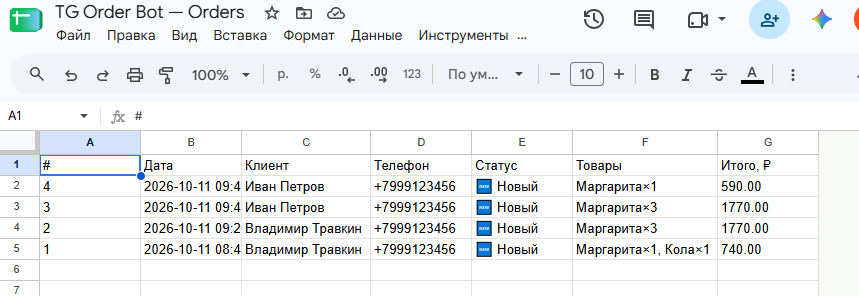

# tg-order-bot

**English** | [Русский](README.ru.md)

[](https://github.com/VladimirTravkin/tg-order-bot/actions/workflows/ci.yml)
[](https://www.python.org/downloads/)
[](https://docs.aiogram.dev/)
[](https://www.postgresql.org/)
[](https://redis.io/)
[](https://www.docker.com/)
[](https://github.com/astral-sh/ruff)
[](https://opensource.org/licenses/MIT)

A production-ready Telegram bot for accepting orders: product catalog, shopping
cart, checkout flow, admin panel with order management, and one-click export
to Google Sheets.

**Live demo:** [@vm13_tg_order_bot](https://t.me/vm13_tg_order_bot)

---

## 📸 Demo

### Animated walkthrough



### Screenshots

| Catalog | Products | Product card | Cart |
|---|---|---|---|
|  |  |  |  |

| Admin notification | Admin orders | Order detail | Google Sheets |
|---|---|---|---|
|  |  |  |  |

---

## 💼 Business value

- **Orders 24/7 without an operator.** Customers browse the catalog and place
  orders on their own — you only confirm.
- **Instant admin notifications.** Every new order triggers a Telegram message
  with customer contacts and order details.
- **Google Sheets instead of a CRM.** One click exports all orders to a
  spreadsheet — handy for small businesses that don't need a full CRM.
- **Deploys to a VPS in 15 minutes.** Docker Compose + Alembic migrations +
  ready `.env.example`.

---

## What it does

- 🛍 **Product catalog** — categories and product cards with photos
- 🛒 **Shopping cart** — add, remove, view items
- 📝 **Order checkout** — name, phone, comment
- 🔧 **Admin panel** — view orders, change status, broadcast messages
- 🔔 **Notifications** — admin gets pinged on every new order
- 📊 **Google Sheets export** — one-click export of orders
- 🔎 **Filter orders** — by status (new, in progress, done, cancelled)

---

## Tech stack

- **Python 3.11+**
- **aiogram 3** — Telegram Bot API framework
- **PostgreSQL 16** + **SQLAlchemy 2.0** (async) + **asyncpg**
- **Redis 7** — FSM state storage
- **Alembic** — database migrations
- **pydantic-settings** — configuration
- **uv** — dependency management
- **Ruff** — linter and formatter
- **pytest** — testing (46 tests)
- **Docker** + **docker-compose** — local infrastructure and deployment

---

## Quick start

> Requires Python 3.11+, [uv](https://docs.astral.sh/uv/), and [Docker](https://www.docker.com/products/docker-desktop/).

```bash
# 1. Clone the repository
git clone https://github.com/VladimirTravkin/tg-order-bot.git
cd tg-order-bot

# 2. Install dependencies
uv sync

# 3. Set up environment
cp .env.example .env
# Edit .env: set BOT_TOKEN (from @BotFather) and ADMIN_IDS (from @userinfobot)

# 4. Start PostgreSQL and Redis
make db-up

# 5. Apply database migrations
make migrate

# 6. Run the bot
make run
```

---

## Local development

### Infrastructure

PostgreSQL 16 and Redis 7 run in Docker containers:

```bash
make db-up      # start containers
make db-ps      # check status (should be "healthy")
make db-logs    # tail logs
make db-down    # stop (data preserved)
make db-reset   # stop and WIPE all data
```

### Quality checks

```bash
make lint       # ruff check
make format     # ruff format
make test       # pytest
make check      # lint + test (before commit)
```

### Database migrations

```bash
make migrate                     # apply all pending migrations
make migration m="add users"     # create new migration
```

### Running the whole stack in Docker

```bash
make bot-up        # build and start bot + postgres + redis
make bot-logs      # tail bot logs
make bot-down      # stop the bot (infrastructure keeps running)
make bot-rebuild   # rebuild after code changes
```

Or with plain Docker Compose:

```bash
docker compose up -d         # start postgres + redis + bot
docker compose ps            # check status
docker compose logs -f bot   # tail bot logs
docker compose down          # stop everything (data preserved)
```

> **Note:** the bot only runs on a machine that has a real `BOT_TOKEN` in `.env`.
> When someone clones this repository, they must create their own bot via
> [@BotFather](https://t.me/BotFather) and put the new token into their `.env`.

---

## Deploy to VPS

Tested on Ubuntu 22.04 with Docker and Docker Compose installed.

```bash
# 1. Clone the repository on the server
git clone https://github.com/VladimirTravkin/tg-order-bot.git /opt/tg-order-bot
cd /opt/tg-order-bot

# 2. Create the environment file
cp .env.example .env
nano .env
# Set BOT_TOKEN, ADMIN_IDS, POSTGRES_*, REDIS_*, GOOGLE_CREDENTIALS_PATH, GOOGLE_SPREADSHEET_ID

# 3. (Optional) Add Google Service Account key
mkdir -p secrets
# Copy google-credentials.json into secrets/ and lock down permissions
chmod 644 secrets/google-credentials.json

# 4. Start the stack
docker compose up -d

# 5. Apply migrations
docker compose exec bot alembic upgrade head

# 6. (Optional) Seed catalog data
docker compose exec -T bot python -c "
import asyncio
from tg_order_bot.database.models.catalog import Category, Product
from tg_order_bot.database.session import async_session_factory
# ... see scripts/ for the full seed snippet
"

# 7. Check logs
docker compose logs -f bot
```

To update after a code change:

```bash
git pull
docker compose up -d --build bot
docker compose exec bot alembic upgrade head
```

---

## Environment variables

All variables are read via `pydantic-settings` from `.env`.

| Variable | Required | Description |
|---|---|---|
| `BOT_TOKEN` | ✅ | Telegram bot token from [@BotFather](https://t.me/BotFather) |
| `ADMIN_IDS` | ✅ | Comma-separated Telegram user IDs with admin access |
| `POSTGRES_USER` | ✅ | PostgreSQL user (must match `docker-compose.yml`) |
| `POSTGRES_PASSWORD` | ✅ | PostgreSQL password |
| `POSTGRES_HOST` | ✅ | PostgreSQL host (`localhost` for local, `postgres` in Docker) |
| `POSTGRES_PORT` | ✅ | PostgreSQL port (default `5432`) |
| `POSTGRES_DB` | ✅ | PostgreSQL database name |
| `REDIS_HOST` | ✅ | Redis host (`localhost` for local, `redis` in Docker) |
| `REDIS_PORT` | ✅ | Redis port (default `6379`) |
| `REDIS_DB` | ✅ | Redis database index (default `0`) |
| `ENVIRONMENT` | ✅ | `dev` or `prod` |
| `LOG_LEVEL` | ✅ | `DEBUG` / `INFO` / `WARNING` / `ERROR` |
| `GOOGLE_CREDENTIALS_PATH` | ⚪ | Path to the Service Account JSON key |
| `GOOGLE_SPREADSHEET_ID` | ⚪ | Spreadsheet ID; leave empty to disable export |

---

## Project structure

```
tg-order-bot/
├── src/tg_order_bot/
│   ├── __main__.py          # entry point (polling)
│   ├── config.py            # pydantic-settings
│   ├── bot.py               # Bot + Dispatcher setup
│   ├── database/            # SQLAlchemy models, session, base
│   ├── common/              # middlewares, shared keyboards, labels
│   ├── catalog/             # catalog handlers, keyboards, service
│   ├── cart/                # cart handlers, service
│   ├── orders/              # checkout FSM, order service
│   ├── admin/               # admin panel: orders, statuses, broadcast
│   └── infrastructure/      # Google Sheets export
├── tests/                   # pytest test suite (46 tests)
├── scripts/                 # helper scripts
├── docs/                    # screenshots, demo.gif, ARCHITECTURE.ru.md
├── alembic/                 # migrations
├── Dockerfile
├── docker-compose.yml
├── Makefile
├── pyproject.toml
├── .env.example
└── README.md / README.ru.md
```

Architecture details (RU, with Mermaid diagrams): [`docs/ARCHITECTURE.ru.md`](docs/ARCHITECTURE.ru.md)

---

## Development

Before committing:

```bash
make check   # ruff check + pytest
```

Commits follow [Conventional Commits](https://www.conventionalcommits.org/)
(`feat:`, `fix:`, `docs:`, `test:`, `build:`, `ci:`, `style:`, `chore:`).

---

## Project status

✅ **Live** — the bot is deployed on a VPS and running 24/7.

- ✅ 46 tests passing
- ✅ Docker + docker-compose
- ✅ GitHub Actions CI
- ✅ Google Sheets export
- ✅ Deployed on VPS (`vm13.vps.oblako.sh:/opt/tg-order-bot`)

See [Issues](https://github.com/VladimirTravkin/tg-order-bot/issues) for the roadmap.

---

## Contact

- **Telegram:** [@TravkinVladimir](https://t.me/TravkinVladimir)
- **Email:** [vpro68@mail.ru](mailto:vpro68@mail.ru)
- **GitHub:** [@VladimirTravkin](https://github.com/VladimirTravkin)

Open to freelance projects — Telegram is the fastest way to reach me.

---


## License

[MIT](LICENSE)
