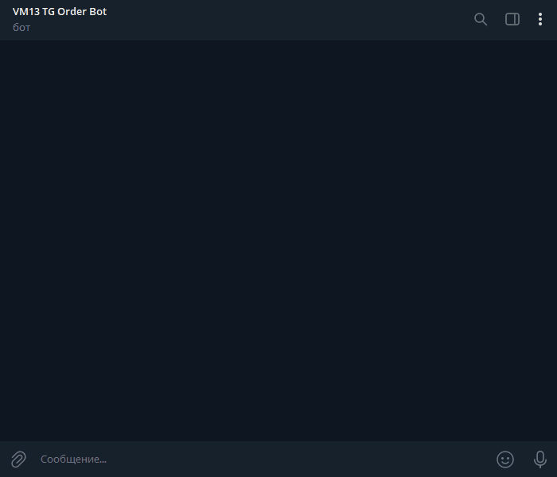
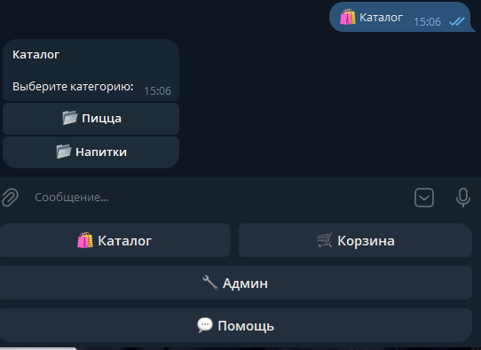
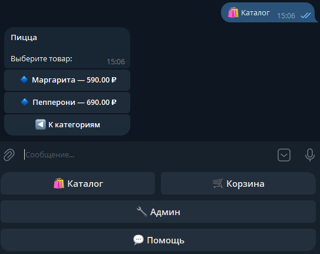
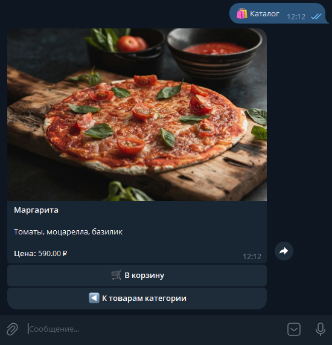
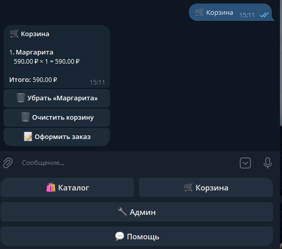
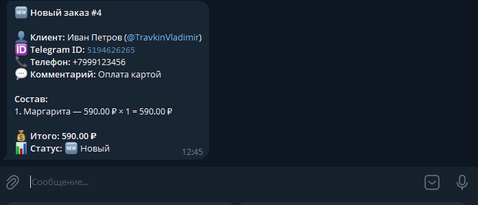
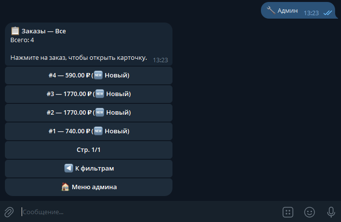
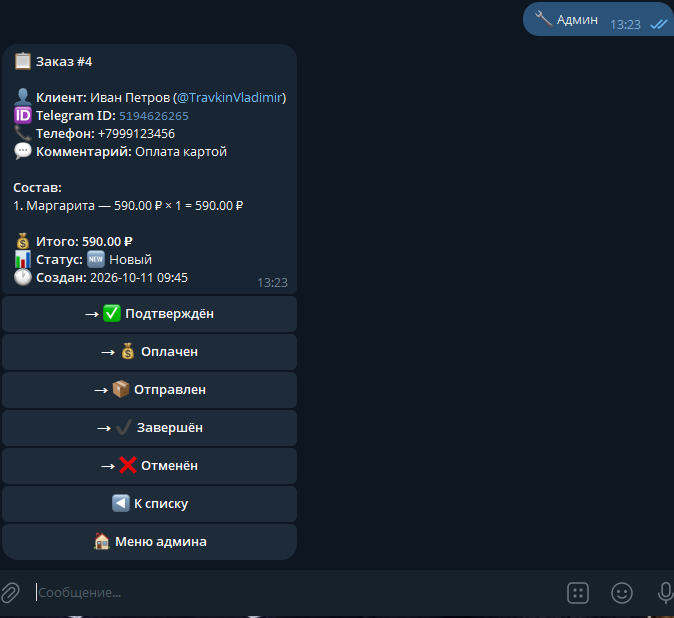
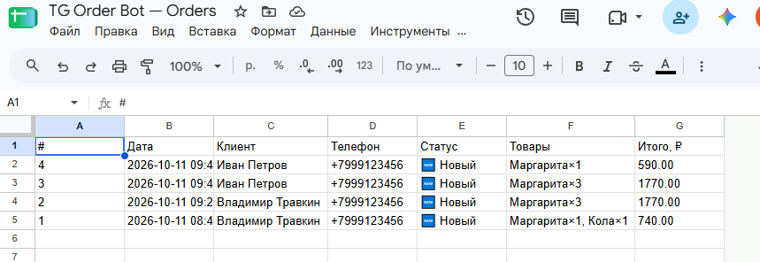

# tg-order-bot

🇷🇺 Русский · [🇬🇧 English](README.md)

[](https://github.com/VladimirTravkin/tg-order-bot/actions/workflows/ci.yml)
[](https://www.python.org/downloads/)
[](https://docs.aiogram.dev/)
[](https://www.postgresql.org/)
[](https://redis.io/)
[](https://www.docker.com/)
[](https://github.com/astral-sh/ruff)
[](https://opensource.org/licenses/MIT)

Telegram-бот для приёма заказов под ключ: каталог товаров с фото, корзина,
оформление заказа, админ-панель с управлением заказами и выгрузка
в Google Sheets одной кнопкой.

**Живой бот:** [@vm13_tg_order_bot](https://t.me/vm13_tg_order_bot)

---

## 📸 Демо

### Анимированный обзор



### Скриншоты

| Каталог | Товары | Карточка товара | Корзина |
|---|---|---|---|
|  |  |  |  |

| Уведомление админу | Список заказов | Карточка заказа | Google Sheets |
|---|---|---|---|
|  |  |  |  |

---

## 💼 Бизнес-ценность

- **Приём заказов 24/7 без оператора.** Клиенты сами смотрят каталог и
  оформляют заказ — вам остаётся только подтвердить.
- **Мгновенные уведомления админу.** На каждый новый заказ приходит сообщение
  в Telegram с контактами клиента и составом заказа.
- **Google Sheets вместо CRM.** Выгрузка всех заказов в таблицу одной кнопкой —
  удобно для малого бизнеса, которому не нужна полноценная CRM.
- **Развёртывание на VPS за 15 минут.** Docker Compose + миграции Alembic +
  готовый `.env.example`.

---

## Что умеет

- 🛍 **Каталог товаров** — категории и карточки товаров с фото
- 🛒 **Корзина** — добавление, удаление, просмотр
- 📝 **Оформление заказа** — имя, телефон, комментарий
- 🔧 **Админ-панель** — просмотр заказов, смена статуса, рассылка
- 🔔 **Уведомления** — админ получает сообщение о каждом новом заказе
- 📊 **Выгрузка в Google Sheets** — экспорт заказов одной кнопкой
- 🔎 **Фильтры заказов** — по статусу (новые, в работе, завершённые, отменённые)

---

## Стек

- **Python 3.11+**
- **aiogram 3** — фреймворк для Telegram Bot API
- **PostgreSQL 16** + **SQLAlchemy 2.0** (async) + **asyncpg**
- **Redis 7** — хранение FSM-состояний
- **Alembic** — миграции БД
- **pydantic-settings** — конфигурация
- **uv** — управление зависимостями
- **Ruff** — линтер и форматтер
- **pytest** — тестирование (46 тестов)
- **Docker** + **docker-compose** — локальная инфраструктура и деплой

---

## Быстрый старт

> Требуется Python 3.11+, [uv](https://docs.astral.sh/uv/) и [Docker](https://www.docker.com/products/docker-desktop/).

```bash
# 1. Клонировать репозиторий
git clone https://github.com/VladimirTravkin/tg-order-bot.git
cd tg-order-bot

# 2. Установить зависимости
uv sync

# 3. Настроить окружение
cp .env.example .env
# Отредактировать .env: указать BOT_TOKEN (от @BotFather) и ADMIN_IDS (от @userinfobot)

# 4. Поднять PostgreSQL и Redis
make db-up

# 5. Применить миграции
make migrate

# 6. Запустить бота
make run
```

---

## Локальная разработка

### Инфраструктура

PostgreSQL 16 и Redis 7 работают в Docker-контейнерах:

```bash
make db-up      # поднять контейнеры
make db-ps      # проверить статус (должно быть "healthy")
make db-logs    # смотреть логи
make db-down    # остановить (данные сохраняются)
make db-reset   # остановить и УДАЛИТЬ все данные
```

### Проверки качества

```bash
make lint       # ruff check
make format     # ruff format
make test       # pytest
make check      # lint + test (перед коммитом)
```

### Миграции БД

```bash
make migrate                     # применить все миграции
make migration m="add users"     # создать новую миграцию
```

### Запуск всего стека в Docker

```bash
make bot-up        # собрать и запустить бота + postgres + redis
make bot-logs      # смотреть логи бота
make bot-down      # остановить бота (инфраструктура продолжает работать)
make bot-rebuild   # пересобрать после изменения кода
```

Либо напрямую через Docker Compose:

```bash
docker compose up -d         # запустить postgres + redis + бота
docker compose ps            # проверить статус
docker compose logs -f bot   # логи бота
docker compose down          # остановить всё (данные сохраняются)
```

> **Важно:** бот работает только на машине, где в `.env` указан **реальный**
> `BOT_TOKEN`. Тот, кто клонирует репозиторий, должен создать **своего** бота
> через [@BotFather](https://t.me/BotFather) и вписать **свой** токен в `.env`.

---

## Деплой на VPS

Проверено на Ubuntu 22.04 с установленными Docker и Docker Compose.

```bash
# 1. Клонировать репозиторий на сервер
git clone https://github.com/VladimirTravkin/tg-order-bot.git /opt/tg-order-bot
cd /opt/tg-order-bot

# 2. Создать .env
cp .env.example .env
nano .env
# Указать BOT_TOKEN, ADMIN_IDS, POSTGRES_*, REDIS_*, GOOGLE_CREDENTIALS_PATH, GOOGLE_SPREADSHEET_ID

# 3. (Опционально) Добавить ключ Google Service Account
mkdir -p secrets
# Скопировать google-credentials.json в secrets/ и выставить права
chmod 644 secrets/google-credentials.json

# 4. Запустить стек
docker compose up -d

# 5. Применить миграции
docker compose exec bot alembic upgrade head

# 6. (Опционально) Залить каталог
docker compose exec -T bot python -c "
import asyncio
from tg_order_bot.database.models.catalog import Category, Product
from tg_order_bot.database.session import async_session_factory
# ... полный скрипт см. в scripts/
"

# 7. Проверить логи
docker compose logs -f bot
```

Обновление после изменения кода:

```bash
git pull
docker compose up -d --build bot
docker compose exec bot alembic upgrade head
```

---

## Переменные окружения

Все переменные читаются через `pydantic-settings` из `.env`.

| Переменная | Обяз. | Описание |
|---|---|---|
| `BOT_TOKEN` | ✅ | Токен Telegram-бота от [@BotFather](https://t.me/BotFather) |
| `ADMIN_IDS` | ✅ | ID админов через запятую (узнать: [@userinfobot](https://t.me/userinfobot)) |
| `POSTGRES_USER` | ✅ | Пользователь PostgreSQL (совпадать с `docker-compose.yml`) |
| `POSTGRES_PASSWORD` | ✅ | Пароль PostgreSQL |
| `POSTGRES_HOST` | ✅ | Хост PostgreSQL (`localhost` локально, `postgres` в Docker) |
| `POSTGRES_PORT` | ✅ | Порт PostgreSQL (по умолчанию `5432`) |
| `POSTGRES_DB` | ✅ | Имя базы данных |
| `REDIS_HOST` | ✅ | Хост Redis (`localhost` локально, `redis` в Docker) |
| `REDIS_PORT` | ✅ | Порт Redis (по умолчанию `6379`) |
| `REDIS_DB` | ✅ | Индекс БД Redis (по умолчанию `0`) |
| `ENVIRONMENT` | ✅ | `dev` или `prod` |
| `LOG_LEVEL` | ✅ | `DEBUG` / `INFO` / `WARNING` / `ERROR` |
| `GOOGLE_CREDENTIALS_PATH` | ⚪ | Путь к JSON-ключу Service Account |
| `GOOGLE_SPREADSHEET_ID` | ⚪ | ID таблицы; пусто — выгрузка отключена |

---

## Структура проекта

```
tg-order-bot/
├── src/tg_order_bot/
│   ├── __main__.py          # точка входа (polling)
│   ├── config.py            # pydantic-settings
│   ├── bot.py               # Bot + Dispatcher
│   ├── database/            # SQLAlchemy-модели, сессии, base
│   ├── common/              # middleware, общие клавиатуры, labels
│   ├── catalog/             # каталог: хендлеры, клавиатуры, сервис
│   ├── cart/                # корзина: хендлеры, сервис
│   ├── orders/              # FSM оформления, сервис заказов
│   ├── admin/               # админка: заказы, статусы, рассылка
│   └── infrastructure/      # выгрузка в Google Sheets
├── tests/                   # pytest (46 тестов)
├── scripts/                 # вспомогательные скрипты
├── docs/                    # скриншоты, demo.gif, ARCHITECTURE.ru.md
├── alembic/                 # миграции
├── Dockerfile
├── docker-compose.yml
├── Makefile
├── pyproject.toml
├── .env.example
└── README.md / README.ru.md
```

Подробнее об архитектуре: [`docs/ARCHITECTURE.ru.md`](docs/ARCHITECTURE.ru.md)

---

## Разработка

Перед коммитом:

```bash
make check   # ruff check + pytest
```

Коммиты — по [Conventional Commits](https://www.conventionalcommits.org/)
(`feat:`, `fix:`, `docs:`, `test:`, `build:`, `ci:`, `style:`, `chore:`).

---

## Статус проекта

✅ **Работает** — бот развёрнут на VPS и работает 24/7.

- ✅ 46 тестов проходят
- ✅ Docker + docker-compose
- ✅ GitHub Actions CI
- ✅ Выгрузка в Google Sheets
- ✅ Задеплоен на VPS (`vm13.vps.oblako.sh:/opt/tg-order-bot`)

См. [Issues](https://github.com/VladimirTravkin/tg-order-bot/issues) для дорожной карты.

---

## Контакты

- **Telegram:** [@TravkinVladimir](https://t.me/TravkinVladimir)
- **Email:** [vpro68@mail.ru](mailto:vpro68@mail.ru)
- **GitHub:** [@VladimirTravkin](https://github.com/VladimirTravkin)

Открыт для фриланс-проектов — быстрее всего писать в Telegram.

---


## Лицензия

[MIT](LICENSE)
