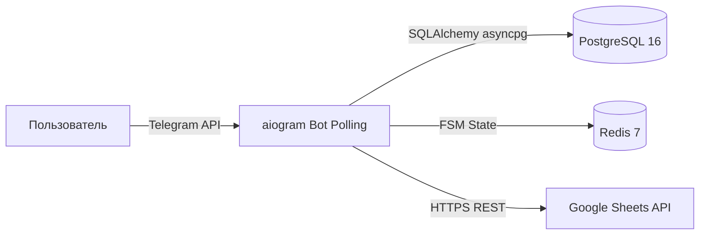
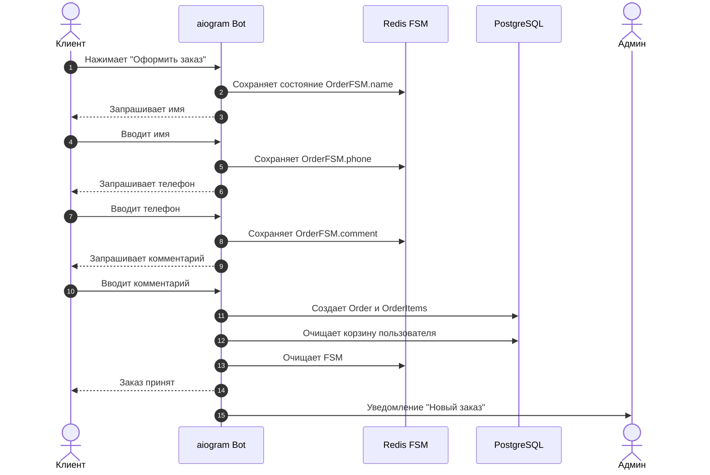
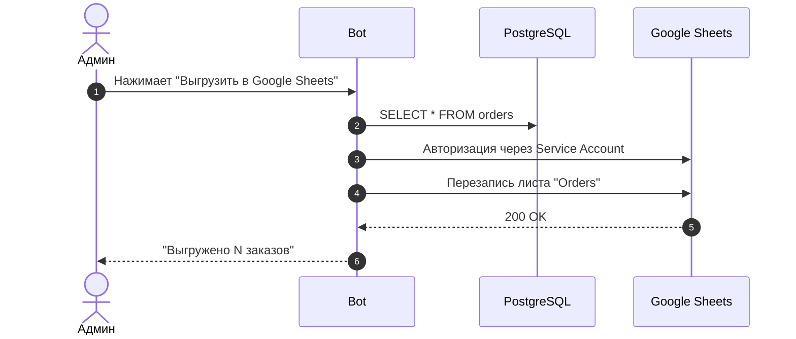
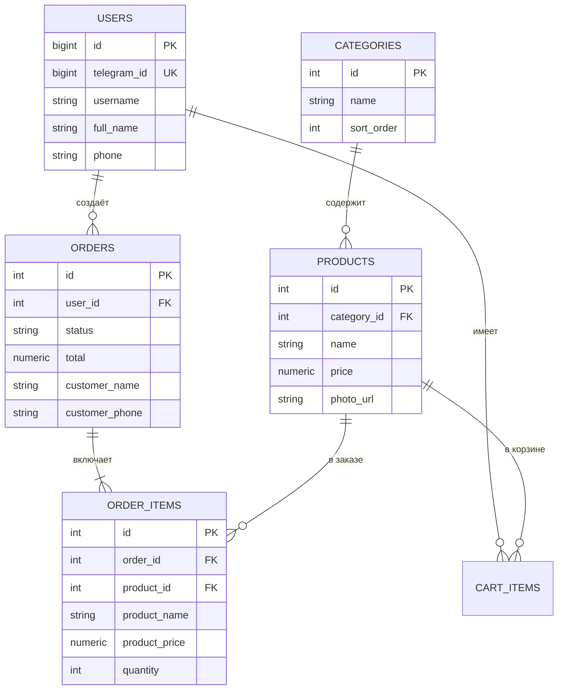
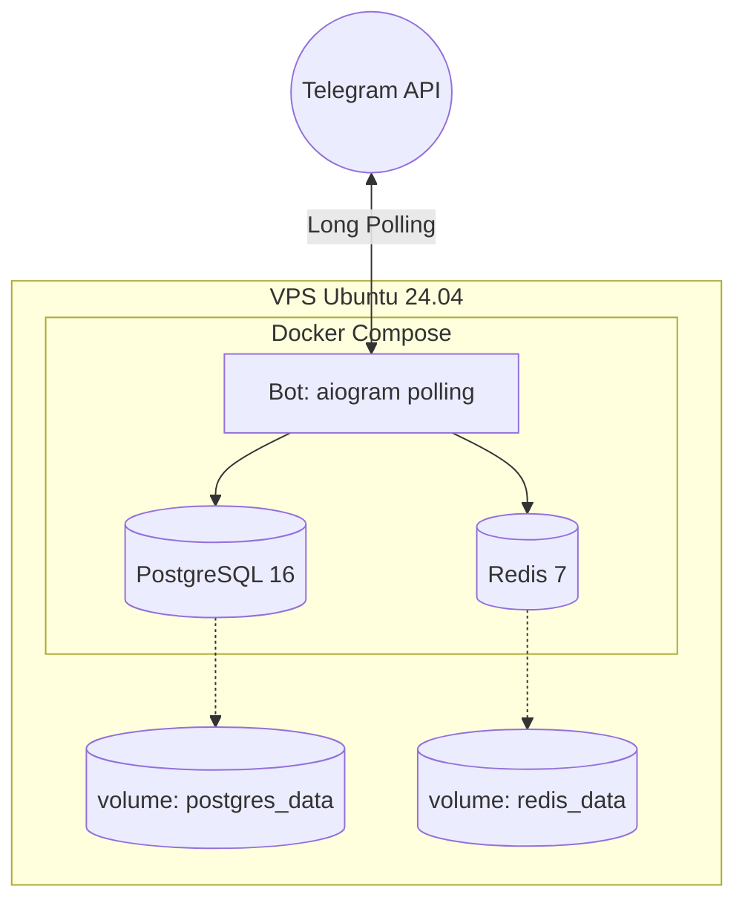

# Архитектура проекта: Telegram-бот для приёма заказов

> Документ описывает архитектуру, потоки данных, модель данных и принятые
> инженерные решения. Цель — объяснить **почему** система устроена именно так,
> а не просто перечислить компоненты.

## Оглавление

1. [Обзор](#1-обзор)
2. [Компоненты и схема](#2-компоненты-и-схема)
3. [Потоки данных](#3-потоки-данных)
4. [Модель данных](#4-модель-данных)
5. [Безопасность](#5-безопасность)
6. [Инфраструктура и деплой](#6-инфраструктура-и-деплой)
7. [Допущения по нагрузке](#7-допущения-по-нагрузке)
8. [Вне рамок проекта (Out of scope)](#8-вне-рамок-проекта-out-of-scope)
9. [Trade-offs (ADR-lite)](#9-trade-offs-adr-lite)

---

## 1. Обзор

**Продукт.** Telegram-бот для приёма заказов, работающий внутри мессенджера.
Пользователь проходит полный цикл покупки: каталог → корзина → оформление
заказа. Администратор получает уведомления, управляет статусами заказов и
выгружает данные в Google Sheets.

**Ключевая идея.** Дать малому бизнесу (пиццерии, салоны, доставки) простой
инструмент для приёма заказов без необходимости покупать дорогую CRM или
разрабатывать отдельное мобильное приложение.

**Что входит в MVP:**

- Витрина: категории, список товаров с фото, карточка товара.
- Корзина (хранится в БД и привязана к пользователю).
- Оформление заказа (FSM: имя, телефон, комментарий).
- Уведомления: подтверждение клиенту + сообщение админу.
- Админ-панель: список заказов, фильтрация по статусам, смена статуса, рассылка.
- Выгрузка заказов в Google Sheets в один клик.

**Стек:**

| Слой | Технологии |
|---|---|
| Backend | Python 3.11, aiogram 3, SQLAlchemy 2.0 (async), Alembic, pydantic-settings |
| БД | PostgreSQL 16 |
| FSM Storage | Redis 7 |
| Интеграции | Google Sheets API (Service Account) |
| Инфраструктура | Docker, Docker Compose, VPS (Ubuntu 24.04) |
| Линтер / Тесты | Ruff, pytest (46 тестов) |

---

## 2. Компоненты и схема

**Роли компонентов:**

- **Telegram Client** — интерфейс для клиента и админа.
- **aiogram Bot** — сердце системы. Ловит апдейты через Long Polling, обрабатывает логику, ходит в БД.
- **PostgreSQL** — единственный источник истины (каталог, заказы, пользователи).
- **Redis** — хранит состояния FSM (шаги оформления заказа), чтобы они не терялись при рестарте бота.
- **Google Sheets** — внешнее хранилище для отчетов (заменяет админку в MVP).

---

## 3. Потоки данных

### 3.1. Оформление заказа (FSM)

### 3.2. Выгрузка в Google Sheets

---

## 4. Модель данных

**Ключевые решения по модели:**
- **Снапшоты в `orders` и `order_items`.** Если завтра админ изменит цену пиццы или удалит товар, история заказов не поедет. В `order_items` мы сохраняем `product_name` и `product_price` на момент покупки.
- **`lazy="raise"` в SQLAlchemy.** Защита от случайных N+1 запросов. Заставляет разработчика явно указывать жадную загрузку (`selectinload`), чтобы код не тормозил.
- **`numeric` для денег.** Никаких `float`, только точная десятичная арифметика.
- **Каскады.** `CASCADE` на удаление юзера (его заказы и корзина тоже удаляются), `SET NULL` на удаление товара (чтобы не сломать историю).

---

## 5. Безопасность

### 5.1. Защита БД и инфраструктуры
- **Порты PostgreSQL и Redis проброшены только на `127.0.0.1`**. Снаружи (из интернета) база недоступна. Это защищает от брутфорс-атак, которые часто случаются на открытых портах `5432`.
- **Пароль БД** — сложный, генерируется случайно, не `postgres`.
- **Пользователь БД** — нестандартный (`tg_bot_user`), не `postgres`.

### 5.2. Защита админ-панели
- Доступ к админке контролируется через `AdminFilterMiddleware`.
- Если ID пользователя нет в списке `ADMIN_IDS` (из `.env`), бот даже не покажет ему кнопку "Админ", а любые попытки вызвать админские `callback` будут заблокированы.

### 5.3. Защита от спама
- `ThrottlingMiddleware` ограничивает количество сообщений от одного пользователя в секунду (защита от флуда).

### 5.4. Работа с секретами
- Токен бота, пароли БД и ключ Google Service Account (`.json`) лежат в `.env` и `secrets/`. Они **никогда не коммитятся в Git** (добавлены в `.gitignore`).

---

## 6. Инфраструктура и деплой

**Особенности деплоя:**
- Запуск происходит через `docker compose up -d`.
- Для обновления кода используется стратегия: `git pull && docker compose up -d --build bot`. Пересобирается только контейнер бота, база и Redis не перезапускаются, чтобы не терять соединения.
- Миграции БД накатываются внутри контейнера через `alembic upgrade head`.
- **CI/CD:** Настроен GitHub Actions (`ci.yml`), который на каждый пуш прогоняет линтер (`ruff`) и тесты (`pytest`).

---

## 7. Допущения по нагрузке

Проект рассчитан на **малый и средний бизнес**: одна точка (пиццерия, салон).
- DAU: до 500 человек.
- RPS (пиковая): до 10 запросов в секунду.
- SKU в каталоге: до 500 позиций.

**Архитектура Long Polling** (а не Webhook) выбрана для простоты деплоя на VPS без необходимости настраивать домен и SSL-сертификаты. При росте нагрузки бот легко переводится на Webhook.

---

## 8. Вне рамок проекта (Out of scope)

Эти функции не вошли в MVP, но заложены в архитектуру как точки роста:

- **Онлайн-оплата** — в текущей версии бот принимает заказ, а оплата происходит вне бота (переводом или при получении).
- **Веб-админка** — управление товарами и категориями происходит напрямую через SQL (скрипты заливки). Полноценная админка — следующий шаг.
- **Интеграция с CRM** — вместо этого выгрузка в Google Sheets (дешево и сердито).
- **Корзина для неавторизованных** — корзина привязана к `user_id` в БД, поэтому сохраняется при перезапуске бота (в отличие от `localStorage`).
- **Мультиязычность** — интерфейс только на русском.
- **Промокоды и скидки** — не реализованы.

---

## 9. Trade-offs (ADR-lite)

| # | Решение | Обоснование |
|---|---|---|
| 1 | **aiogram 3** | Асинхронность «из коробки», удобные роутеры, FSM. |
| 2 | **Long Polling вместо Webhook** | Не нужен домен, SSL и проброс портов для локальной разработки. Идеально для MVP. |
| 3 | **Redis для FSM** | Если сервер перезагрузится, состояния оформления заказа не потеряются. |
| 4 | **Стратегия `replace` (удалить + отправить) в каталоге** | Telegram не позволяет использовать `edit_text` на сообщениях с фото. Удаление и отправка нового сообщения — единственный надежный способ навигации «текст ↔ фото». |
| 5 | **Снапшоты цен в заказах** | Гарантирует, что бухгалтерия не поедет, если товар подорожает. |
| 6 | **Синхронная выгрузка в Google Sheets** | В MVP заказов мало (до 1000), выгрузка занимает секунды. Для десятков тысяч понадобилась бы фоновая задача (Celery). |
| 7 | **Docker для всего стека** | Одинаковое окружение локально и на VPS. Упрощает деплой до одной команды. |
